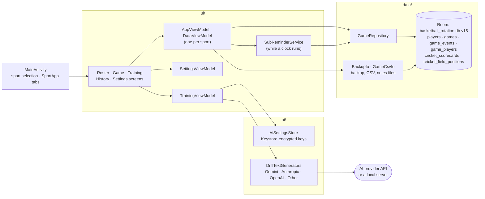

# Project Structure

Coaches Assistant is an Android application (`:app`) built with Kotlin,
Jetpack Compose, Room, and optional AI-generated training drills. A second
module, `:baselineprofile`, generates its baseline profile. The
application supports 17 sports while sharing the same roster, game, event,
export, and persistence infrastructure.

## Top-level layout

```text
.
├── .github/
│   ├── dependabot.yml                 # Weekly dependency and Actions update PRs
│   └── workflows/
│       └── android-ci.yml             # Tests, lint, and a release build on pushes/PRs to master
├── app/
│   ├── schemas/                       # Exported Room database schemas
│   ├── proguard-rules.pro             # Release R8/ProGuard rules
│   ├── build.gradle.kts               # Android module configuration and dependencies
│   └── src/
│       ├── main/                      # Production Android application
│       ├── release/generated/baselineProfiles/  # Generated baseline profile (see README)
│       └── test/                      # Unit and UI tests (JVM, Robolectric)
├── baselineprofile/                   # Generates the baseline profile; startup benchmark
├── docs/
│   └── privacy-policy.md              # Privacy policy draft for the Play listing
├── gradle/
│   ├── libs.versions.toml             # Central dependency and plugin versions
│   └── wrapper/                       # Gradle wrapper configuration
├── build.gradle.kts                   # Root plugin declarations
├── settings.gradle.kts                # Project and repository configuration
├── gradle.properties                  # Gradle build properties
├── gradlew / gradlew.bat              # Gradle wrapper entry points
├── README.md                          # Product overview, setup, and feature documentation
├── DEVELOPMENT_HISTORY.md             # Version and implementation history
└── STRUCTURE.md                       # This guide
```

Generated build output is written to `build/` and `app/build/`. Local
configuration such as `local.properties` is not committed.

## Application source

Production code lives under:

```text
app/src/main/java/com/lukearnold/coachesassistant/
```

### Application entry point

- `MainActivity.kt` initializes the Compose content and routes between the
  sport-selection screen and the sport-specific application shell.
- `SportApp` owns the top-level tab navigation (back returns to the main tab
  before leaving the app), responsive navigation rail or
  bottom navigation, the view models, and screen composition.

### `ui/` - Compose screens and presentation logic

The UI package contains the screens, reusable components, view models, and
presentation helpers:

- `SportSelectionScreen.kt` - landing screen for choosing one of the 17 sports.
- `RosterScreen.kt` - roster management, CSV import, and CSV export.
- `GameScreen.kt` - top-level live-game screen.
- `GameControlPanel.kt` - timer, scoring, lineup, and substitution controls.
- `GameStatsPanel.kt` - game selection, player statistics, and event display.
- `PlayerActionCard.kt` - per-player live game actions.
- `GameDialogs.kt` - attendance and event editing dialogs.
- `Confirmations.kt` - the confirmation dialog and its messages (ending a game, deleting a game or player, changing period, resetting the clock).
- `GameNotesPanel.kt` - coaching notes and TXT export.
- `GameFormatting.kt` - event descriptions, period labels, and time formatting.
- `LiveGameClock.kt` - the Game screen's single live clock ticker, shared by the game clock, player cards, and stats.
- `KeepScreenOn.kt` - keeps the screen awake while a game clock runs, and the setting that controls it.
- `GameClockNotification.kt` - the optional running-clock notification (a system-counted countdown with a Stop clock action) and its receiver.
- `GameDayMode.kt` - Game Day mode: the app's own Do Not Disturb rule, on from its button until the game ends, and the button with its access prompt.
- `PlayingTime.kt` - equal-share playing-time targets, pace labels, the bench substitution order, and substitution suggestions.
- `SubReminders.kt` - the substitution suggestion settings, the check for a suggestion, its notification and "Later" snooze, and the Sub now receiver.
- `SubReminderService.kt` - the foreground service that keeps checking for substitution reminders while a clock runs, even with the app in the background.
- `Fielding.kt` - how many players a starting lineup can have given who's here (full side, short-handed down to the sport's minimum, or too few), and the per-sport minimum setting.
- `GameHistoryScreen.kt` - finished-game history, viewing, exporting, and deletion, with the season summary on top.
- `SeasonStats.kt` - season totals (team record and per-player totals) across a sport's finished games.
- `TrainingScreen.kt` - the AI training assistant (drills for the current sport and an age group).
- `SettingsScreen.kt` - sport switching, display, AI provider settings, backup and restore, and data clearing.
- `Components.kt` - shared Compose components, including game list cards.
- `ResponsiveLayout.kt` - compact and expanded layout decisions.
- `Theme.kt` - the app's Material 3 theme (dark mode and Android 12+ dynamic color).
- `FileExport.kt` - shared file-export launcher.
- `SportConfig.kt` - sport-specific rules: players on court and the minimum to field a team, scoring, periods, positions, and infractions.
- `SportPreferences.kt` - remembers the last selected sport.
- `CricketGameScreen.kt` / `CricketField.kt` - cricket's Game tab: the score, a scorecard per player, and the field plan diagram.
- `CricketViewModel.kt` / `CricketStats.kt` - cricket's scorecards, field plans, and season totals (averages, strike rate, economy).
- `AppLanguage.kt` - the languages offered under Settings → Language, and switching between them.
- `AppViewModel.kt` - one sport's roster and live game: screen state, user actions, and repository coordination.
- `DataViewModel.kt` - backup and restore, CSV and notes files, and clearing data.
- `SettingsViewModel.kt` - the app-wide display and substitution settings.
- `ViewModelActions.kt` - `launchSafely`, which turns a failed user action into a message instead of a crash.
- `PlayerGameStats.kt` - the per-game player stats calculator (`calculatePlayerGameStats`).
- `UiMessages.kt` - snackbar messages (with optional Undo) and their text.
- `UiText.kt` - text built in code as a string resource and its arguments, resolved when shown.
- `TrainingViewModel.kt` - AI provider selection, endpoint configuration, the
  model chosen for each provider, API key state, and drill generation (which
  can be cancelled, cancelling its network call).

### `data/` - domain and persistence

The data package defines the multi-sport domain model and local Room database:

- `Sport.kt` - supported sport enum and sport metadata.
- `Entities.kt` - Room entities for players, games, game events, and each game's lineup (`game_players`: who's on court or absent).
- `Dao.kt` - Room data access objects.
- `AppDatabase.kt` - Room database, version 15, and migrations.
- `GameRepository.kt` - repository operations used by the view models.
- `Cricket.kt` / `CricketPosition.kt` / `CricketRepository.kt` - cricket's scorecards and field plans (entities, overs and totals helpers, the fielding positions and where they go on the field), and saving them.
- `Backup.kt` / `BackupIo.kt` - the whole-app backup file format, and backing up to / restoring from a file the user picks.
- `GameCsvIo.kt` - roster CSV import and export, game CSV export, and the coaching notes TXT export.
- `MvpVotes.kt` - serialization and parsing for MVP vote data.
- `UserFacingException.kt` - failures that carry a message (a string resource) for the user.

The database is local-first and is stored in a Room database named
`basketball_rotation.db`. Room schema snapshots are kept in
`app/schemas/com.lukearnold.coachesassistant.data.AppDatabase/`.

### `ai/` - training assistant integrations

The AI package is used by the Training tab (every sport):

- `AiProvider.kt` - supported providers and provider metadata.
- `CustomEndpointConfig.kt` - configuration for an OpenAI-compatible endpoint.
- `Drill.kt` - parsed drill model.
- `DrillParsing.kt` - prompt construction and response parsing.
- `DrillTextGenerators.kt` - provider-specific text generation implementations
  for Gemini, Anthropic, OpenAI, and custom OpenAI-compatible services.
- `AiSettingsStore.kt` - the selected provider, endpoint, and API keys, with
  keys encrypted by an Android Keystore key.
- `LocalNetworkAccess.kt` - when the Other provider points at a server on the
  local network, which needs Android 17's local network permission.

API keys are supplied by the user in Settings and encrypted on the device
(`AiSettingsStore`, which also moves over settings from older versions). Debug
builds can take a Gemini build-time fallback through `GEMINI_API_KEY` in
`local.properties`; release builds never include it.

## Android resources

Resources live under `app/src/main/res/`:

```text
res/
├── drawable/
│   ├── ic_launcher_background.xml
│   └── ic_launcher_foreground.xml
├── mipmap-anydpi/
│   ├── ic_launcher.xml
│   └── ic_launcher_round.xml
├── mipmap-{mdpi,hdpi,xhdpi,xxhdpi,xxxhdpi}/
│   └── launcher bitmap assets
├── values/
│   ├── colors.xml
│   ├── strings.xml
│   ├── style.xml
│   └── themes.xml
├── values-night/
│   └── themes.xml
├── values-{es,fr,it}/
│   └── strings.xml                   # Spanish, French, and Italian translations
├── resources.properties              # The default strings' language (English)
└── xml/
    ├── backup_rules.xml
    ├── data_extraction_rules.xml
    └── network_security_config.xml
```

`values/strings.xml` holds all the app's text: screen text, messages, errors,
and sport data (sport names, positions, scoring buttons, infractions). Screens
read it with `stringResource(R.string...)`; text built in code (snackbar
messages, confirmations, event descriptions, errors) is a `UiText` (a resource
and its arguments) that's turned into words only when shown, so it follows a
change of language. The app is translated into Spanish, French, and Italian
(`values-es`, `values-fr`, `values-it`), chosen under Settings → Language
(`ui/AppLanguage.kt`; `MainActivity` is an `AppCompatActivity` so the choice
also applies before Android 13). `TranslationsTest` checks that each
translation has every string and plural with the same placeholders. To add a
language, add `values-<lang>/strings.xml` with the same names, add it to
`AppLanguage` and `TranslationsTest`, and keep lint clean (it checks plural
forms per language). Set its
`content_language_tag` to the language's tag (e.g. `fr`), so AI drills are
requested in that language. The build generates the list of the app's
languages from these folders (`generateLocaleConfig`, with English as the
default from `res/resources.properties`), so a new translation also appears in
Android's per-app language setting (Android 13+).

A few things stay in English on purpose: what's stored (players' position
codes, the event notes such as "Finished Period 2", which the event log shows
translated), CSV column headers, and the prompt sent to the AI provider.

`AndroidManifest.xml` declares the launcher activity, application label, icon,
backup behavior, network security config, and permissions: internet access for
the AI providers, local network access (Android 17+) for a server on the
local network, Do Not Disturb access for Game Day mode (granted by the user
in system settings), and notifications (Android 13+) for the optional game
clock notification. It also declares the receiver for that notification's
Stop clock action.

`network_security_config.xml` allows plain http so the Other provider can
reach a local server; `DrillTextGenerators.kt` refuses any plain http request
that isn't to the local network.

## Tests

All tests are under `app/src/test/` and run on the JVM
(`./gradlew testDebugUnitTest`), with no emulator. Those needing Android use
Robolectric:

- `ai/` - drill prompt and parsing, provider response parsing, requests
  against a local mock server (`DrillTextGeneratorsTest`), endpoint URL
  checks, local network detection, and the encrypted settings store.
- `data/` - the repository against an in-memory Room database, database
  migrations (from the exported schemas), backup format and restore, CSV
  import and export, event types, game totals, and MVP votes.
- `ui/` - player and season stats, playing-time targets, sport configuration,
  confirmation and other message text, the clock editor, keep-screen-on, the
  `AppViewModel` and `TrainingViewModel` (with a fake AI provider), and
  Compose UI tests of screens (`ScreenBehaviourTest`).

There are no instrumented (`androidTest`) tests. CI
(`.github/workflows/android-ci.yml`) checks formatting, then runs the tests, lint, and a release
build on every push and pull request to master, and builds a signed release
bundle on pushes when the signing secrets are set (see README, "Publishing").

## Build and dependency configuration

- `settings.gradle.kts` configures plugin/dependency repositories and includes
  the `:app` module.
- Root `build.gradle.kts` declares shared Android, Kotlin Compose, and KSP
  plugins, and configures Spotless (ktlint) formatting: `./gradlew spotlessCheck`
  checks it and `./gradlew spotlessApply` fixes it.
- `app/build.gradle.kts` configures SDK levels, application ID, build types,
  Compose, Room/KSP, and runtime dependencies. It also derives the version
  (`versionCode` from the commit count, `versionName` from the latest `vX.Y.Z`
  tag), signs release builds when an upload key is supplied, and builds the
  transition build over the old app ID with `-PlegacyAppId`.
- `gradle/libs.versions.toml` centralizes dependency versions and aliases.
- Release builds use R8 minification and resource shrinking.

## Main runtime flow



The selected sport is persisted independently from roster and game data.
`AppViewModel` and `DataViewModel` instances are keyed by sport so each sport's state remains
isolated while using the same application screens and repository patterns. Screens collect state
with `collectAsStateWithLifecycle`, so the view models' `WhileSubscribed` flows (and their Room
queries) stop a few seconds after the app goes into the background.
